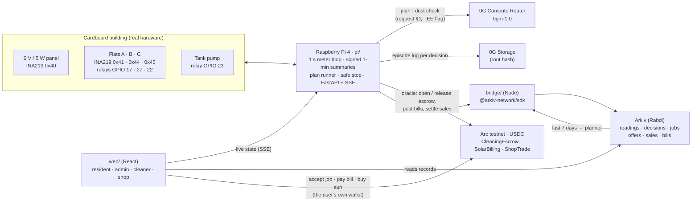

# Dynaura

**AI-run shared solar for apartment buildings.**

A Raspberry Pi meters every flat and the rooftop panel. **Dyna**, an AI planner running on **0G**, decides when the flats run on sun and when the water pump runs, and it checks a dusty panel before any money moves. **Arc** USDC pays the panel cleaner automatically, and only once the meter proves the panel is clean. **Arkiv** keeps an open record book that residents, the committee and the cleaner can all read, with entries that expire on their own.

> **0G decides, Arc pays, Arkiv remembers.**

Built from scratch at ETHGlobal Mumbai (5–7 Nov 2026) by Om Salunkhe, Devang Gandhi and Pawan.

| | |
|---|---|
| Demo video | **TBD** |
| Live app | **TBD** (Vercel; the Pi-backed parts are live only on the venue network, see [Run it](#run-it)) |
| Arc Studio project | [studio.arc.io/app/63db67fa…](https://studio.arc.io/app/63db67fa-4bd2-4ba1-a1c5-e7740437e852) |
| Arc contracts | [CleaningEscrow](https://explorer.testnet.arc.io/address/0xf215116c72784e7490ddf3166dcb53b84855b8b9) · [SolarBilling](https://explorer.testnet.arc.io/address/0x5bd5aecc43968994e90f33df7177fb384401902b) · [ShopTrade](https://explorer.testnet.arc.io/address/0x17b2d9561991f4f7c0d43a5f0be19dc07c73ef47) (Arc testnet, chain 5042002; [`deployments.json`](contracts/deployments.json)) |
| Arkiv building wallet | **TBD** (Rabdi testnet, chain 7794095) |
| Prize tracks | 0G: Build with 0G PC · Arc: Best Smart Contracts with Advanced Stablecoin Logic, In Arc Studio · Arkiv: Build on Arkiv (from scratch) |

---

## The problem

Maharashtra now lets the residents of an apartment building share one solar system. In 2024 the state electricity regulator (MERC) added **virtual net metering** to its rooftop rules, so "residential consumers in multi-storied buildings" can set up one renewable system and share its output ([Mercom, Sept 2024](https://mercomindia.com/merc-proposes-virtual-net-metering-in-rooftop-renewable-energy-system-rules)). In October 2025 MERC fined the state utility, MSEDCL, ₹1 lakh after three housing societies complained that it was not implementing it ([Saur Energy, Oct 2025](https://www.saurenergy.com/solar-energy-news/merc-imposes-penalty-on-msedcl-not-implementing-virtual-net-metering-10588428)).

Once a building shares one roof, someone has to run it:
- **Who used how much sun?** Each flat's share has to come from a meter, not an estimate.
- **When should the shared loads run?** The tank pump, the borewell and the EV charger should run in the strongest sun, not at dawn on grid power.
- **Who keeps the panel clean?** A dusty panel quietly loses output for weeks. Paying a cleaner today means trusting someone's word that the job was done.

Today that's a committee member with a spreadsheet and a WhatsApp group. Dynaura runs it with a meter that signs its readings, an AI that has to show its work, payments that need no approval, and a record book anyone can check.

## How it works

The hero flow, as shown in the demo:

1. **Plan (0G).** Every evening the Pi sends Dyna tomorrow's sun forecast, the last 7 days of use (read back from Arkiv) and who is away. Dyna answers on **0G Compute** with a plan: the solar window, when each shared job runs, and tips per flat. The Pi keeps the 0G request ID and TEE flag, and uploads the full episode log to **0G Storage**.
2. **Run.** Relays move each flat between solar (yellow LED) and grid (blue LED), and the pump runs at its planned slot. The Pi meters everything once a second and signs every 1-minute summary with its device key.
3. **Dust.** Tracing paper on the panel plays the dust. Output falls below 70% of a clean panel under the same light, and the building locks a **2 USDC cleaning fee in an escrow on Arc**.
4. **Clean.** A cleaner accepts the job from their own wallet and cleans the panel.
5. **Paid by the sun.** When the meter sees output back above 90%, the Pi (the escrow's only oracle) releases the USDC to the cleaner. Nobody presses "approve". If nobody cleans it by the deadline, the society gets its money back.
6. **Remembered (Arkiv).** Every reading, decision, job, sale and bill is written to Arkiv by the building's wallet, so the app, the cleaner and any judge can read and check them without asking us.

**If 0G is unreachable,** Dyna never fakes a decision. The building drops to a safe stop: every flat on grid, the pump off, logged as "no AI".

### Architecture



As an image: [`docs/img/architecture.png`](docs/img/architecture.png), with the escrow steps in [`docs/diagram.md`](docs/diagram.md). Wiring and roles: [`docs/architecture.md`](docs/architecture.md).

### The hardware

<!-- TODO(Devang/Pawan): photo of the built model, taken at the event -> docs/img/building.jpg -->
A three-flat cardboard building under a desk lamp:

| Part | Detail |
|---|---|
| Panel | 6 V / 5 W, metered by an INA219 at `0x40` |
| Flats A, B, C | One INA219 each (`0x41`, `0x44`, `0x45`) and one relay each (GPIO 17, 27, 22): solar or grid |
| Water pump | Relay on GPIO 23 |
| Relay board | Active-low, 4 channels. If the software dies, every flat falls back to grid (the safe default) |
| Brain | Raspberry Pi 4; `systemd` restarts the API within seconds |

The same code runs without the board in **SIM mode** (`DYNAURA_HW=sim`), with a simulated sun and demo buttons for cloud, dust and cleaning.

## 0G: the brain

*Track: Build with 0G PC. The AI planner on 0G is the product: without it the building has no plan.*

- **A 0G call in the decision loop.** [`pi/planner.py`](pi/planner.py) asks the 0G Compute Router (OpenAI-compatible, `verify_tee: true`) for the daily plan. The Pi validates the JSON, and the relays and pump act on it ([`pi/jobs.py`](pi/jobs.py)). Ask Dyna ([`pi/dyna.py`](pi/dyna.py)) answers residents on 0G too.
- **An episode log on 0G Storage with a request ID per decision.** [`pi/og_storage.py`](pi/og_storage.py) uploads each decision's full log (input, raw answer, request ID, model, TEE fields) and keeps its root. The root is also written to the decision's Arkiv entity.
- **A safe stop with no faked decision.** [`pi/brain.py`](pi/brain.py): if 0G or the forecast fails, the plan is cleared, every flat goes to grid, the pump stops, and a `no-ai` decision is logged and uploaded like any other.
- **A reason to come back tomorrow.** Every evening Dyna plans the next day from the forecast and the last 7 days on Arkiv, and every resident sees their own tips on Home.
- **Real hardware**: a metered cardboard building with relays, shown live.

**What breaks if 0G is removed:** the building has no plan. Every flat stays on grid, no shared job moves into the sun, and no money is locked for a cleaner, because the Pi refuses to act on a decision it can't prove.

**Proofs from our runs:** <!-- TODO(dy-demo): fill from GET /api/decisions after the live run -->

| Decision | 0G request ID | 0G Storage root | Arkiv entity |
|---|---|---|---|
| Daily plan | TBD | TBD | TBD |
| Dust check | TBD | TBD | TBD |
| No-AI safe stop | — (no 0G call) | TBD | TBD |
| Ask Dyna | TBD | TBD | TBD |

Explorers: [0G Storage (Galileo)](https://storagescan-galileo.0g.ai) · [0G Chain (Galileo)](https://chainscan-galileo.0g.ai).

## Arc: the money

*Bounty: **Best Smart Contracts with Advanced Stablecoin Logic, In Arc Studio**.*

Three USDC contracts, **written, tested and deployed in [Arc Studio](https://studio.arc.io/app/63db67fa-4bd2-4ba1-a1c5-e7740437e852)** to Arc testnet (chain 5042002), with the source verified on the explorer. They use USDC (the ERC-20 at `0x3600…0000`, 6 decimals) for both money and gas. The **oracle** is the Pi's wallet: the only address allowed to release a fee, settle a sale or post a bill, and only from what its own meters measured. The **owner** is the society committee: it can change the oracle and treasury and settle disputes.

| Contract | Stablecoin logic | Address |
|---|---|---|
| [`CleaningEscrow`](contracts/src/CleaningEscrow.sol) | **Conditional escrow with on-chain dispute and automatic release.** A dusty panel locks the fee together with the 0G request ID of the AI decision that flagged it. A cleaner accepts, and the oracle releases the fee only when output is back to 90–100% (checked on chain), storing the hash of the meter readings that proved it. The cleaner can dispute (on a cloudy day, say), and the committee resolves it. After the deadline anyone can refund the society. `linkEpisode` ties each job to the 0G Storage root of its episode log | [`0xf215…b8b9`](https://explorer.testnet.arc.io/address/0xf215116c72784e7490ddf3166dcb53b84855b8b9) |
| [`SolarBilling`](contracts/src/SolarBilling.sol) | **Payment splitting.** Each month the oracle posts every flat's bill from its own meter, with the hash of the signed readings behind it. One payment is split by where the power came from: the solar part goes to the society treasury and the grid part to the electricity board, in the same transaction | [`0x5bd5…902b`](https://explorer.testnet.arc.io/address/0x5bd5aecc43968994e90f33df7177fb384401902b) |
| [`ShopTrade`](contracts/src/ShopTrade.sol) | **Multi-step settlement.** A nearby shop prepays for spare noon sun. After the window the oracle settles by the Wh actually delivered: the society is paid and the shop gets the rest back in one transaction. If the meter never settles, the shop takes its deposit back after the deadline | [`0x17b2…ef47`](https://explorer.testnet.arc.io/address/0x17b2d9561991f4f7c0d43a5f0be19dc07c73ef47) |

Deploy transactions: [escrow](https://explorer.testnet.arc.io/tx/0x7bc2adcd3d0ef6e07fa149b7bad08fc9e62a52bccb23cbded3c393b82c649063) · [billing](https://explorer.testnet.arc.io/tx/0x7588f283b6e87e6c74b8d1b990b890f71b5156bf5bfd4b5fc3edf6aae29101bb) · [shop trade](https://explorer.testnet.arc.io/tx/0xc31cf4804ad4fae68b765af046fe043ff88af0ab555d570526b7e700f811bb3f). All addresses and settings: [`contracts/deployments.json`](contracts/deployments.json).

**What was done in Arc Studio and what was done locally** (full story: [`contracts/STUDIO.md`](contracts/STUDIO.md)):
- **In Studio:** Studio wrote the three contracts from our spec prompt ([`contracts/studio/`](contracts/studio/)), with our first drafts as read-only context. It ran three rounds of its own security and functional review plus static analysis, and wrote 161 Foundry tests (fuzz and invariant). It then passed our 50 acceptance tests without changing them, 211/211 green. Studio deployed all three contracts from its Circle smart wallet (ERC-4337, gas paid by a paymaster) and verified the source.
- **Locally:** we wrote the first drafts, the spec and prompts, the 50 acceptance tests and a reference implementation to check Studio's output against. We pulled Studio's code into [`contracts/src/`](contracts/src/) byte for byte, re-ran all 211 tests, and checked that the deployed bytecode matches a local build (only the metadata hash differs). We also wired the contracts into the Pi (Python) and the web app (viem).

**Safety:** OpenZeppelin `SafeERC20`, `ReentrancyGuard` and `Ownable2Step` (ownership can't be renounced), nothing `payable`, and an event for every state change. Neither the oracle nor the committee can accept a cleaning job, so neither can pay itself. A payout to a frozen USDC address doesn't block the job: the amount waits for its recipient to claim.

**For the demo,** the oracle, the committee and the treasury are all the Pi's wallet. In a real building the committee would be the society's multisig.

**Reusable by other builders:** `CleaningEscrow` is a generic "pay when a device proves the job is done" escrow. Swap the panel meter for any sensor (a water-tank level, a lift's uptime, an air-quality reading) and it works unchanged.

## Arkiv: the record book

*Track: Build on Arkiv (from scratch).*

Every record is written by one **building wallet** through [`bridge/`](bridge/) with `@arkiv-network/sdk`. Readers always filter by that owner, because anyone can write any tag. No names, phone numbers or addresses are stored, only flats `A`, `B`, `C`.

What expiry does for us:
- **Heartbeat, 2 minutes, renewed every 30 s.** If the Pi goes quiet, the entity expires and the app shows "Building offline". There is no monitoring server; the expiry is the alarm.
- **Shop offers expire when the solar window closes.** The market closes itself.
- **Cleaning jobs expire after their deadline.** The lasting record is the maintenance entry written when a job is paid.
- **Readings last 7 days, daily totals and bills about 6 months.**

What reads from Arkiv: Dyna's planner (the last 7 days of daily totals go into every 0G prompt), the History timeline, the "Building online" badge, shop offers and the maintenance log. They're read straight from the browser, with no server in between.

- Schema: [`arkiv/schema.md`](arkiv/schema.md)
- Judging files: [`friction.md`](arkiv/friction.md) · [`reach.md`](arkiv/reach.md) · [`why-arkiv.md`](arkiv/why-arkiv.md) · [`how-you-use-arkiv.md`](arkiv/how-you-use-arkiv.md)
- **Building wallet:** TBD
- **A query you can run:** <!-- TODO(dy-arkiv): copy-paste query (curl or a 5-line node script) for the latest decisions owned by the building wallet --> TBD

## Run it

**SIM mode, no board needed** (Python 3.11+ and Node 22.10+):

```bash
git clone https://github.com/Om-Salunkhe/Dynaura.git && cd Dynaura
cp .env.example .env                 # the defaults run in SIM mode; set ARKIV_ENABLED=false to skip Arkiv

cd pi
python3 -m venv .venv && .venv/bin/pip install -r requirements.txt
DYNAURA_HW=sim .venv/bin/python api.py          # → http://localhost:8000/api/state

# second terminal
cd web && npm install && cp .env.example .env && npm run dev   # → http://localhost:5173
```

Without a 0G key, the first plan fails and the building goes into the no-AI safe stop. That's the fallback working. Add `ZG_API_KEY` in `.env` to get real plans. Arc and Arkiv switch on when their keys and addresses are set; every variable is explained in [`.env.example`](.env.example).

**On the Raspberry Pi:** [`deploy/README.md`](deploy/README.md) (systemd units for the API and the Arkiv bridge). **Contracts:** [`contracts/README.md`](contracts/README.md).

The web app on Vercel is served over https, so it can't call the Pi's plain-http API. At the venue, run the app on a laptop on the same network as the Pi.

## Repo map

| Folder | What's in it |
|---|---|
| [`pi/`](pi/) | Python on the Pi: meter loop, 0G planner, job runner, cleaning watch, Arc and Arkiv clients, FastAPI |
| [`pi/hw/`](pi/hw/) | Hardware layer: `sim.py` (simulated building) and `real.py` (INA219s + relays) |
| [`bridge/`](bridge/) | Node service that writes and reads Arkiv entities for the Pi |
| [`contracts/`](contracts/) | Solidity for Arc (escrow, billing, shop trade), ABIs and tests |
| [`web/`](web/) | React app for residents, the committee, the cleaner and shops |
| [`arkiv/`](arkiv/) | Arkiv schema and judging files |
| [`deploy/`](deploy/) | systemd units and the Pi setup guide |
| [`docs/`](docs/) | Architecture and AI-usage notes |

## Team

| Who | Did | Telegram | X |
|---|---|---|---|
| Om Salunkhe | Pi software, contracts, web app | TBD | TBD |
| Devang Gandhi | Hardware: the building, wiring, meters, relays | TBD | TBD |
| Pawan | Product, sponsor integrations, demo and docs | TBD | TBD |

## AI usage

We used AI coding assistants. [`docs/ai-usage/`](docs/ai-usage/) says where and how, part by part, with the prompts and plans we worked from.

## Arkiv

Records live on Arkiv's Rabdi testnet (chain 7794095), written by one building wallet and read by
the app straight from the browser. Schemas, judging notes and more queries are in [`arkiv/`](arkiv/README.md).

- Building wallet (demo, `sunrise-apartments`): **TODO** address from the Pi bridge's `/health`
- Test wallet (`test-dyarkiv-1`): [`0xd961a5C42dd84F003Ef3C85a1bD08BE59A8717Cd`](https://rabdi.explorer.arkiv.network/address/0xd961a5C42dd84F003Ef3C85a1bD08BE59A8717Cd)

The building's latest AI decisions, with their 0G proofs (no key or SDK needed):

```bash
curl -s https://rpc.rabdi.db-chain.testnet.arkiv.network \
  -H 'Content-Type: application/json' --data @- <<'EOF'
{"jsonrpc":"2.0","id":1,"method":"arkiv_query","params":[
  "arkiv.schema = str('dynaura.decision') AND building = str('test-dyarkiv-1') AND $creator = addr(0xd961a5C42dd84F003Ef3C85a1bD08BE59A8717Cd) AND $owner = addr(0xd961a5C42dd84F003Ef3C85a1bD08BE59A8717Cd) ORDER BY decision_id:u64 DESC",
  {"select":{"key":true,"expiresAt":true,"attributes":{"kind":true,"day":true,"og_request_id":true,"og_storage_root":true}},"limit":"0x3"}]}
EOF
```

## Status

[MIT](LICENSE)
