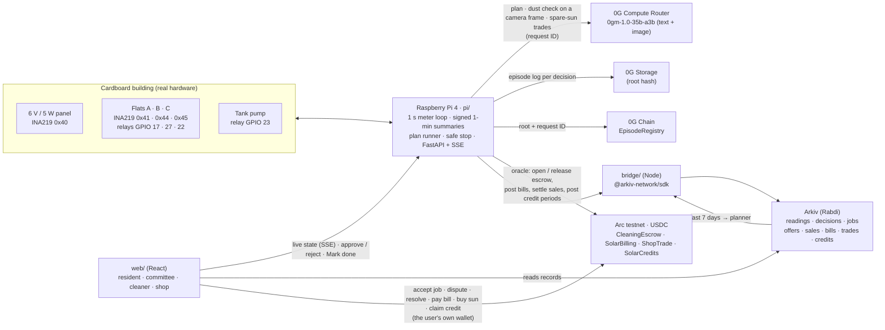

# Dynaura

**AI-run shared solar for apartment buildings.**

A Raspberry Pi meters every flat and the rooftop panel. **Dyna**, an AI planner running on **0G**, decides when the flats run on sun and when the water pump runs, and it checks a dusty panel before any money moves. **Arc** USDC pays the panel cleaner automatically, and only once the meter proves the panel is clean. **Arkiv** keeps an open record book that residents, the committee and the cleaner can all read, with entries that expire on their own.

> **0G decides, Arc pays, Arkiv remembers.**

Built from scratch at ETHGlobal Mumbai (5–7 Nov 2026) by Om Salunkhe, Devang Gandhi and Pawan.

| | |
|---|---|
| Demo video | **TBD** |
| Live app | **TBD** (Vercel; the Pi-backed parts are live only on the venue network, see [Run it](#run-it)) |
| Arc Studio project | [studio.arc.io/app/63db67fa…](https://studio.arc.io/app/63db67fa-4bd2-4ba1-a1c5-e7740437e852) |
| Arc contracts | [CleaningEscrow](https://explorer.testnet.arc.io/address/0xf215116c72784e7490ddf3166dcb53b84855b8b9) · [SolarBilling](https://explorer.testnet.arc.io/address/0x5bd5aecc43968994e90f33df7177fb384401902b) · [ShopTrade](https://explorer.testnet.arc.io/address/0x17b2d9561991f4f7c0d43a5f0be19dc07c73ef47) · [SolarCredits](https://explorer.testnet.arc.io/address/0x12b06e364ecc08aead9ce2142382682b9d46859c) (Arc testnet, chain 5042002; [`deployments.json`](contracts/deployments.json)) |
| 0G contract | [EpisodeRegistry `0xb62f…a984`](https://chainscan-galileo.0g.ai/address/0xb62f4531f035d5cd188799d96bac553b5d7da984) (0G Galileo testnet, chain 16602, source verified; [`zerog/`](zerog/)) |
| Arkiv building wallet | [`0xd961…17Cd`](https://rabdi.explorer.arkiv.network/address/0xd961a5C42dd84F003Ef3C85a1bD08BE59A8717Cd) (Rabdi testnet, chain 7794095; building `sunrise-apartments`) |
| Prize tracks | 0G: Physical AI: Agents with a Body · Arc: Best Smart Contracts with Advanced Stablecoin Logic, In Arc Studio · Arkiv: Build on Arkiv (from scratch) |

---

## The problem

Maharashtra now lets the residents of an apartment building share one solar system. In 2024 the state electricity regulator (MERC) added **virtual net metering** to its rooftop rules, so "residential consumers in multi-storied buildings" can set up one renewable system and share its output ([Mercom, Sept 2024](https://mercomindia.com/merc-proposes-virtual-net-metering-in-rooftop-renewable-energy-system-rules)). In October 2025 MERC fined the state utility, MSEDCL, ₹1 lakh after three housing societies complained that it was not implementing it ([Saur Energy, Oct 2025](https://www.saurenergy.com/solar-energy-news/merc-imposes-penalty-on-msedcl-not-implementing-virtual-net-metering-10588428)).

Once a building shares one roof, someone has to run it:
- **Who used how much sun?** Each flat's share has to come from a meter, not an estimate.
- **When should the shared loads run?** The tank pump, the borewell and the EV charger should run in the strongest sun, not at dawn on grid power.
- **Who earns from the spare sun?** Sun the flats don't use is sold to the grid or a neighbour, and today that money is split equally. The flat that left its share unused gets the same as the one that used it all.
- **Who keeps the panel clean?** A dusty panel quietly loses output for weeks. Paying a cleaner today means trusting someone's word that the job was done.

Today that's a committee member with a spreadsheet and a WhatsApp group. Dynaura runs it with a meter that signs its readings, an AI that has to show its work, a payment only the meter can release, and a record book anyone can check.

## How it works

The hero flow, as shown in the demo:

1. **Plan (0G).** Every evening the Pi sends Dyna tomorrow's sun forecast, the last 7 days of use (read back from Arkiv) and who is away. Dyna answers on **0G Compute** with a plan: the solar window, when each shared job runs, and tips per flat. The Pi keeps the 0G request ID and uploads the full episode log to **0G Storage**.
2. **Run.** Relays move each flat between solar (yellow LED) and grid (blue LED), and the pump runs on the sun in its planned slot. The Pi meters everything once a second and signs every 1-minute summary with its device key.
3. **Share (0G).** Each flat has a fair share of the sun. What flats leave unused is sold: first to neighbours who used more than their share, then, as Dyna on 0G decides, to the shop next door, and the rest to the grid. The money is paid back in proportion to what each flat left unused, not split equally ([Fair share](#fair-share-pay-the-flat-that-saved)).
4. **Look (0G).** Tracing paper on the panel plays the dust. When output falls below 70% of what the panel should give, or the committee presses *Scan panel*, the Pi takes a frame of the panel and asks 0G: is it dirty, how much is covered, and why? The verdict comes back with its 0G request ID. A meter alone can't tell dust from a cloud.
5. **Approve.** A dirty verdict becomes a cleaning request. The committee sees the frame and 0G's verdict in the app and approves it. Only then does the Pi lock a **2 USDC fee in an escrow on Arc**, tagged with that 0G request ID. A rejected request moves no money.
6. **Clean.** A cleaner accepts the job from their own wallet, cleans the panel and taps *Mark done* (that moves no money).
7. **Paid by the meter.** The Pi measures the output again. When it's back to at least 90% of a clean panel, and at least 15 points above the dusty reading, the Pi (the escrow's only oracle) releases the USDC to the cleaner, with the hash of the signed readings as proof. If not, it keeps waiting, and after the deadline the society gets its money back. The cleaner can dispute, and the committee decides.
8. **Remembered (Arkiv).** Every reading, decision, trade, credit period, cleaning request, sale and bill is written to Arkiv by the building's wallet, so the app, the cleaner and any judge can read and check them without asking us.

**If 0G is unreachable,** Dyna never fakes a decision. The building drops to a safe stop (every flat on grid, the pump off), a dust check flags nothing, spare sun is settled by a labelled fixed rule instead of a 0G trade, and the outage itself is logged.

### Architecture



As an image: [`docs/img/architecture.png`](docs/img/architecture.png), with the escrow steps in [`docs/diagram.md`](docs/diagram.md). Wiring and roles: [`docs/architecture.md`](docs/architecture.md).

### The hardware

<!-- TODO(Devang/Pawan): photo of the built model, taken at the event -> docs/img/building.jpg -->
A three-flat cardboard building under a desk lamp:

| Part | Detail |
|---|---|
| Panel | 6 V / 5 W, metered by an INA219 at `0x40` |
| Flats A, B, C | One INA219 each (`0x41`, `0x44`, `0x45`) and one relay each (GPIO 17, 27, 22): solar or grid |
| Water pump | Relay on GPIO 23 |
| Panel camera | One frame of the panel per dust check, which 0G looks at. SIM mode uses sample frames of a clean and a dusty panel |
| Relay board | Active-low, 4 channels. If the software dies, every flat falls back to grid (the safe default) |
| Brain | Raspberry Pi 4; `systemd` restarts the API within seconds |

The same code runs without the board in **SIM mode** (`DYNAURA_HW=sim`), with a simulated sun, sample camera frames and demo buttons for cloud, dust and cleaning.

## Fair share: pay the flat that saved

Say the panel makes 100 units and the two flats sharing it have 50 each. Flat A uses 20 and Flat B uses 40, so 40 units are spare and get sold. A left 30 of its share unused and B left 10.

| | Unused share | Equal split (today) | Dynaura |
|---|---|---|---|
| Flat A | 30 | 50% | **75%** |
| Flat B | 10 | 50% | **25%** |

**The flat that saved gets paid.** Each period (live, then per day and month), from the Pi's signed 1-minute readings:
- Common loads (the pump) come off the top; the rest is split into equal shares (configurable).
- `unused = share − used` for each flat, and `over = used − share` for a flat that needed more.
- **Dyna is the market maker.** Neighbours who used more than their share already drew that sun from the pool, so they're served first, by rule. 0G sets their price inside the band between the feed-in and grid rates (by how scarce the spare is) and decides how much the shop gets, up to its prepaid order; the grid gets the rest at the feed-in rate. Each trade is a 0G decision with a request ID and a reason, and the Pi checks it: routes never exceed the spare and the price stays in the band. If 0G is unreachable, a **fixed rule** applies and is logged as `no-ai`, never shown as a 0G decision: neighbours' drawn energy is settled at the midpoint price, nothing goes to the shop (its prepayment is refunded), and the rest goes to the grid.
- The revenue `R` (neighbour payments + shop + grid export) is paid out as **`earned[flat] = R × unused[flat] / Σ unused`**. The app shows it next to the equal split, so each flat sees the difference.
- **On chain:** the Pi posts each period's measured `unused` and `over` per flat to [`SolarCredits`](https://explorer.testnet.arc.io/address/0x12b06e364ecc08aead9ce2142382682b9d46859c) on Arc, with the hash of the signed meter readings they came from. Buyers pay in, shop and grid revenue is funded in, and each flat **claims `pool × unused / Σ unused`, computed by the contract**. Pawan's day ran on Arc testnet: a pool of 0.40 USDC paid A 0.30 and B 0.10, where an equal split would have paid 0.20 each ([transactions](contracts/README.md#on-chain-proof-arc-testnet-fri-6-and-sat-7-nov)). Every routing and period is also kept on Arkiv (`dynaura.trade`, `dynaura.credit_period`).

The ledger is in `pi/credits.py`, the trading decision in `pi/trader.py`, and the feature sits behind `CREDITS_ENABLED`.

## 0G: the brain

*Track: **Physical AI: Agents with a Body** (and the best-build-on-real-hardware prize).*
<!-- To switch to "Build with 0G PC", change this line and the "Prize tracks" row at the top. The bullets below cover both tracks' must-shows. -->

0G is the brain at the building's checkpoints. The Pi is the spinal cord: it meters, switches relays and keeps everything safe on its own.

- **0G inside the decision loop, at three checkpoints.**
  - **The day's plan.** [`pi/planner.py`](pi/planner.py) asks the [0G Compute Router](https://router-api.0g.ai/v1) (OpenAI-compatible, `verify_tee: true`, model `0gm-1.0-35b-a3b`) for the plan, and the relays and pump follow the validated JSON ([`pi/jobs.py`](pi/jobs.py)).
  - **Is the panel dirty?** When the meter sees output drop, or the committee presses *Scan panel*, `pi/camera.py` captures a frame and `zg.check_dust` sends it to 0G's own model, `0gm-1.0-35b-a3b`, which takes text and images, and asks whether the panel is dirty, how much of it is covered, and why. If the image call isn't available, the same check decides from the meter and the cloud forecast, and the decision is marked `meter-only`. Only a dirty verdict creates a cleaning request, and no money moves until the committee approves it.
  - **Who buys the spare sun?** [`pi/trader.py`](pi/trader.py) serves neighbours who used more than their share first, then asks 0G to set their price inside the feed-in..grid band and to decide how much the shop takes (up to its order). The grid gets the rest. The Pi checks 0G's answer: routes never exceed the spare, only flats over their share can buy, and the price is clamped to the band.
- **An episode log on 0G Storage with a request ID per decision.** Every decision (plan, dust check, trade, Ask Dyna, safe stop) is saved as an episode: the input, the raw 0G answer, the request ID, the model, any TEE fields the Router returns and the building's state, chained to the previous episode by hash. [`pi/og_storage.py`](pi/og_storage.py) uploads it to 0G Storage and retries until it lands.
- **Every episode indexed on 0G Chain.** After each upload the Pi calls [`EpisodeRegistry`](zerog/src/EpisodeRegistry.sol)`.record(root, requestId, ai)` on Galileo ([`0xb62f…a984`](https://chainscan-galileo.0g.ai/address/0xb62f4531f035d5cd188799d96bac553b5d7da984), source verified). That gives judges one contract where every decision is listed in order, AI or not.
- **A safe stop, never a fake verdict.** If 0G can't be reached, the plan is cleared, every flat goes to grid and the pump stops ([`pi/brain.py`](pi/brain.py)). A dust check that can't reach 0G flags nothing and is logged as `no_check`. A trade that can't reach 0G follows a labelled fixed rule (`no-ai`): neighbours at the midpoint price, nothing to the shop, the rest to the grid. Outages are uploaded and anchored like any other decision.
- **Real hardware**, demoed live at the 0G booth, plus a replayable SIM mode.
- **A reason to come back tomorrow.** Every evening Dyna plans the next day from the forecast and the last 7 days on Arkiv, and every resident sees their own tips on Home.

**What breaks if 0G is removed:** Without 0G the building can't see its own panel: a meter alone can't tell dust from a cloud, so it would either pay a cleaner every cloudy afternoon or never notice the dust. And its spare sun would be settled by a fixed rule at the lowest price, with nothing sold to the shop.

**About TEE:** 0G lists `0gm-1.0-35b-a3b` as TEE-attested and the Router marks every call `x-0g-e2ee: sealed`. The Router doesn't return a per-call verification flag, so we never show a call as "TEE verified"; we record any TEE fields that come back.

**Proofs from our runs** (live on the Pi, 6 Nov; full trail in the Arc section below):

| Decision | 0G request ID | 0G Storage root | 0G Chain (EpisodeRegistry) | Arkiv entity |
|---|---|---|---|---|
| Daily plan | `648ffb36-494f-485f-9195-905cd8d0de63` | [`0x9690700b…aee3`](https://storagescan-galileo.0g.ai/submission/160107) | [episode #21](https://chainscan-galileo.0g.ai/tx/0xaa5308fde1cf2c82328852db4a1ede61c562c0a94be2d7eaf3a0edeb02a7c7fb), `ai=true` | TBD |
| Dust check: **dirty, 50% covered** (opened cleaning job 11) | `38b9d5f5-1c88-4dd5-a178-4d5f5ae013ab` | [`0x844bb6aa…dcd6`](https://storagescan-galileo.0g.ai/submission/160068) | [episode #11](https://chainscan-galileo.0g.ai/tx/0x54074ae1d73a33b15a9a4fdddbf8124fdfe032b119bf8e4d2b085d1460e1f238), `ai=true` | cleaning_job [`0xf89c…7abb`](https://rabdi.explorer.arkiv.network/entity/0xf89cb161a52c72ec22db10cec421acdf27cc8096b7b49c775eee58f052ea7abb) |
| Dust check: 0G unreachable (`no_check`) | — (no 0G answer) | TBD | TBD | TBD |
| No-AI safe stop (Pi, 6 Nov 22:34) | — (0G unreachable, no call) | [`0x534e0ec1…5440`](https://storagescan-galileo.0g.ai/submission/159841) | [episode #1](https://chainscan-galileo.0g.ai/tx/0x907d516f0284ec21e3fe7f2686ccf1ea590f5497ba8690ef32a10da5283c015c), `ai=false` | [`0x7980…9c39`](https://rabdi.explorer.arkiv.network/entity/0x798036b1c95ac505f4937ed8484547b50ae10c5fe794e059445acb5f6ea79c39) |
| No-AI safe stop (next) | — | [`0x7d6726af…b4cf`](https://storagescan-galileo.0g.ai/submission/159842) | [episode #2](https://chainscan-galileo.0g.ai/tx/0xeba80bdbf2c9f9de3e1a4aee8bb3726b3fa710171c786805de0fbe6ed192821c), `ai=false` | TBD |
| Ask Dyna | TBD | TBD | TBD | TBD |

We checked both safe-stop rows end to end. We downloaded both logs back from 0G Storage: each is a `plan` decision in mode `no-ai` with every flat on grid. Episode #2's `prev.sha256` equals the sha256 of episode #1's log, byte for byte. On chain, `episodeOf(root)` returns 1 and 2.

Explorers: [0G Storage (Galileo)](https://storagescan-galileo.0g.ai) · [0G Chain (Galileo)](https://chainscan-galileo.0g.ai).

## Arc: the money

*Track: **Best Smart Contracts with Advanced Stablecoin Logic** (In Arc Studio).*

Our USDC contracts were **written, tested and deployed in [Arc Studio](https://studio.arc.io/app/63db67fa-4bd2-4ba1-a1c5-e7740437e852)** to Arc testnet (chain 5042002), with the source verified on the explorer. They use USDC (the ERC-20 at `0x3600…0000`, 6 decimals) for both money and gas. The **oracle** is the Pi's wallet: the only address allowed to release a fee, settle a sale, post a bill or post a credit period, and only from what its own meters measured. The **owner** is the society committee: it resolves disputes and can change the oracle and treasury.

| Contract | Stablecoin logic | Address |
|---|---|---|
| [`CleaningEscrow`](contracts/src/CleaningEscrow.sol) | **Conditional escrow with on-chain dispute and automatic release.** Once 0G flags the dust and the committee approves, the Pi locks the fee together with the 0G request ID of that verdict. A cleaner accepts, cleans and taps Mark done. The oracle releases the fee only when the meter shows the panel back to at least 90% (checked on chain) and clearly better than the dusty reading, storing the hash of the signed readings that proved it. The cleaner can dispute (on a cloudy day, say), and the committee resolves it from its own wallet. After the deadline anyone can refund the society. `linkEpisode` ties each job to the 0G Storage root of its episode log | [`0xf215…b8b9`](https://explorer.testnet.arc.io/address/0xf215116c72784e7490ddf3166dcb53b84855b8b9) |
| [`SolarBilling`](contracts/src/SolarBilling.sol) | **Payment splitting.** Each month the oracle posts every flat's bill from its own meter, with the hash of the signed readings behind it. One payment is split by where the power came from: the solar part goes to the society treasury and the grid part to the electricity board, in the same transaction | [`0x5bd5…902b`](https://explorer.testnet.arc.io/address/0x5bd5aecc43968994e90f33df7177fb384401902b) |
| [`ShopTrade`](contracts/src/ShopTrade.sol) | **Multi-step settlement.** A nearby shop prepays for spare noon sun. After the window the oracle settles by the Wh actually delivered: the society is paid and the shop gets the rest back in one transaction. If the meter never settles, the shop takes its deposit back after the deadline | [`0x17b2…ef47`](https://explorer.testnet.arc.io/address/0x17b2d9561991f4f7c0d43a5f0be19dc07c73ef47) |
| [`SolarCredits`](contracts/src/SolarCredits.sol) | **Pro-rata payout by measured contribution.** The oracle posts each period's measured unused and over-share Wh per flat. Revenue is funded in, and a flat over its share pays in for what it bought from its neighbours. Each flat then claims `pool × unused / Σ unused`, **computed on chain**, to its registered wallet, once. Reusable for any "pay contributors by measured contribution" pool | [`0x12b0…859c`](https://explorer.testnet.arc.io/address/0x12b06e364ecc08aead9ce2142382682b9d46859c) |

Deploy transactions: [escrow](https://explorer.testnet.arc.io/tx/0x7bc2adcd3d0ef6e07fa149b7bad08fc9e62a52bccb23cbded3c393b82c649063) · [billing](https://explorer.testnet.arc.io/tx/0x7588f283b6e87e6c74b8d1b990b890f71b5156bf5bfd4b5fc3edf6aae29101bb) · [shop trade](https://explorer.testnet.arc.io/tx/0xc31cf4804ad4fae68b765af046fe043ff88af0ab555d570526b7e700f811bb3f). All addresses and settings: [`contracts/deployments.json`](contracts/deployments.json).

**What was done in Arc Studio and what was done locally** (full story: [`contracts/STUDIO.md`](contracts/STUDIO.md)):
- **In Studio:** Studio wrote the contracts from our spec prompts ([`contracts/studio/`](contracts/studio/)), with our first drafts as read-only context. It ran three rounds of its own security and functional review plus static analysis, and wrote 161 Foundry tests (fuzz and invariant). It then passed our acceptance tests without changing them. With SolarCredits the suite is **318 tests, all green**: 253 written by Studio (including fuzz, invariant and reentrancy tests) and our 65 acceptance tests. Studio deployed all four contracts from its Circle smart wallet (ERC-4337, gas paid by a paymaster) and verified the source.
- **Locally:** we wrote the first drafts, the spec and prompts, the 50 acceptance tests and a reference implementation to check Studio's output against. We pulled Studio's code into [`contracts/src/`](contracts/src/) byte for byte, re-ran all 211 tests, and checked that the deployed bytecode matches a local build (only the metadata hash differs). We also wired the contracts into the Pi (Python) and the web app (viem).

**Safety:** OpenZeppelin `SafeERC20`, `ReentrancyGuard` and `Ownable2Step` (ownership can't be renounced), nothing `payable`, and an event for every state change. Neither the oracle nor the committee can accept a cleaning job, so neither can pay itself. A payout to a frozen USDC address doesn't block the job: the amount waits for its recipient to claim.

**Roles:** the Pi is the oracle; it opens an escrow only after the committee approves in the app. The committee resolves disputes on chain from its own wallet, not the Pi's. Committee wallet: [`0x6c11…63D6`](https://explorer.testnet.arc.io/address/0x6c11FAcF7DE8C250A3E648aB9F73fBDaFe5563D6), owner of all four contracts. For the demo the treasury is the Pi's wallet; in a real building it, and the committee, would be the society's multisig.

**Transactions:** *live* = the hero run on the Pi (0G flagged real dust, the committee approved, escrow job #3); *e2e* = our scripted run of every path ([`contracts/scripts/e2e.mjs`](contracts/scripts/e2e.mjs)).

| Step | Call | Tx |
|---|---|---|
| Committee approves → escrow opens | `CleaningEscrow.openJob(fee, deadline, outputBefore, ogRequestId)` | [live](https://explorer.testnet.arc.io/tx/0xf6296bce9c99e57d5c3a8df0b4c4b3734cf30a53044b43e95197e4669bf68743) · [e2e](https://explorer.testnet.arc.io/tx/0x5e49a59dcc28633377f04ad15ebc66a618f2888f46e072a3ebc1fc225862b894) |
| Cleaner accepts | `accept(jobId)` | [live](https://explorer.testnet.arc.io/tx/0x7ccafaf3f2a9df579eb891b0c3a1f2824bb935163238cd11c68c519b2f1ec93b) · [e2e](https://explorer.testnet.arc.io/tx/0xc206d3d13e82271d9b59ed96e4302695be7ac5f472bc09a891b9686d389b9739) |
| Meter proves the clean → cleaner paid | `release(jobId, outputAfter, proof)` | [live](https://explorer.testnet.arc.io/tx/0xbb26ef269b7b725f29ce7a084385dc8577b0c516b7542bb46d96b5b9d8ed0cbd) (60.8% → 99.1%) · [e2e](https://explorer.testnet.arc.io/tx/0xee5a1b1b9d2dea939b125e3b40a4613ab99b12022770b4280a373f819614f2e9) |
| Job linked to its 0G episode | `linkEpisode(jobId, ogStorageRoot)` | [live](https://explorer.testnet.arc.io/tx/0x7febaa603e24f31b63545471af3f515e7f37b093ba23d650e3534c538184abc1) · [e2e](https://explorer.testnet.arc.io/tx/0x4576b7945b58dcb404051ff1ddc75bb8bbeaf5848154d32c70700328efaf3d30) |
| Cleaner disputes → committee resolves | `dispute(jobId, reason)` → `resolve(jobId, payCleaner)` | e2e: [dispute](https://explorer.testnet.arc.io/tx/0x7567890a9452e35bfaae8ef36e86f02d75a2d7c82dd63f1dbca898f1d72ab745) → [resolve by the committee](https://explorer.testnet.arc.io/tx/0xdf7ba154225fd9f0514323b596aad4f6b27fdf76f80cffb1dd77b9352b0631e8) (the Pi's resolve is refused) |
| A flat pays its bill (split solar / grid) | `SolarBilling.pay(billId)` | e2e: [postBill](https://explorer.testnet.arc.io/tx/0x86132eba80d909c0416f530d35f89603bd38fa88f5659fba743a615cf09a3b24) → [pay, split](https://explorer.testnet.arc.io/tx/0x21e8b1741c1550a00324935587b16028da566f1dd87a73e426c17faf5c0cfd87) |
| A shop order settles | `ShopTrade.settle(orderId, deliveredWh)` | TBD |
| Fair share: the Pi posts the day, a neighbour pays in, revenue is funded, A and B claim | `SolarCredits.postPeriod` → `payIn` → `fund` → `claim` | e2e, Pawan's day: [postPeriod](https://explorer.testnet.arc.io/tx/0x1e4bf2cac3395c5dcf02af6715886af4ac7681a2e6018fb08e91ccd06dea6cea) (A left 30 kWh, B 10, C used 20 over) → [C pays in](https://explorer.testnet.arc.io/tx/0x039349e236a5f9fca86337da44268d0032140d264024ddf137c9c59a781b45a0) 0.26 → [shop + grid fund](https://explorer.testnet.arc.io/tx/0x59fb00a5149233c3e787712564b77861cf4fb236a8e32cb37d42fe7def501f7f) 0.14 → **[A claims 0.30](https://explorer.testnet.arc.io/tx/0xe26af95abbb552d6a1a1915ae68318afef9c465c4999d2faf9197afbd4c65339)**, **[B claims 0.10](https://explorer.testnet.arc.io/tx/0x3611a7805a4be62f073dfd899f42f36414e521cef70f3d118f4e3e37fb498283)**: pool 0.40 USDC split 3:1 on chain (an equal split: 0.20 each). All transactions: [On-chain proof](contracts/README.md#on-chain-proof-arc-testnet-fri-6-and-sat-7-nov) |

**Reusable by other builders:** `CleaningEscrow` is a generic "pay when a device proves the job is done" escrow, and `SolarCredits` a generic "pay contributors by measured contribution" pool. Swap the panel meter for any sensor (a water-tank level, a lift's uptime, an air-quality reading) and it works unchanged.

## Arkiv: the record book

*Track: Build on Arkiv (from scratch).*

Every record is written by one **building wallet** through [`bridge/`](bridge/) with `@arkiv-network/sdk`. Readers always filter by that owner, because anyone can write any tag. No names, phone numbers or addresses are stored, only flats `A`, `B`, `C`.

What expiry does for us:
- **Heartbeat, 2 minutes, renewed every 30 s.** If the Pi goes quiet, the entity expires and the app shows "Building offline". There is no monitoring server; the expiry is the alarm.
- **Shop offers expire when the solar window closes.** The market closes itself.
- **Cleaning requests expire after their deadline.** Each one carries its state (flagged, approved, paid, rejected…) and its 0G proof. The lasting record is the maintenance entry written when a job is paid.
- **Each 0G trade lasts 30 days; credit periods, like daily totals and bills, about 6 months.** Readings last 7 days.

What reads from Arkiv: Dyna's planner (the last 7 days of daily totals go into every 0G prompt), the cleaner's job board, the History timeline, Bill, Trading, shop offers, the maintenance log and the "Building online" badge. The app reads them straight from the browser, with no server in between.

- Schema: [`arkiv/schema.md`](arkiv/schema.md)
- Judging files: [`friction.md`](arkiv/friction.md) · [`reach.md`](arkiv/reach.md) · [`why-arkiv.md`](arkiv/why-arkiv.md) · [`how-you-use-arkiv.md`](arkiv/how-you-use-arkiv.md)
- **Building wallet:** [`0xd961a5C42dd84F003Ef3C85a1bD08BE59A8717Cd`](https://rabdi.explorer.arkiv.network/address/0xd961a5C42dd84F003Ef3C85a1bD08BE59A8717Cd) (building id `sunrise-apartments`). It writes every record; our live test runs used other building ids.

The building's latest 0G decisions, with their proof fields (no SDK needed):

```bash
ARKIV_KEY=""   # optional: a free key from https://hub.arkiv.network/access-keys
curl -s "https://rpc.rabdi.db-chain.testnet.arkiv.network/${ARKIV_KEY}" \
  -H 'Content-Type: application/json' --data @- <<'EOF'
{"jsonrpc":"2.0","id":1,"method":"arkiv_query","params":[
  "arkiv.schema = str('dynaura.decision') AND building = str('sunrise-apartments') AND $creator = addr(0xd961a5C42dd84F003Ef3C85a1bD08BE59A8717Cd) AND $owner = addr(0xd961a5C42dd84F003Ef3C85a1bD08BE59A8717Cd) ORDER BY decision_id:u64 DESC",
  {"select":{"key":true,"expiresAt":true,"attributes":{"kind":true,"mode":true,"day":true,"og_request_id":true,"og_storage_root":true}},"limit":"0x5"}]}
EOF
```

Without a key, the query uses Arkiv's public endpoint, which has a small free budget. If it answers `{"error":"ANON_COST_LIMITED",…}`, create a free key at [hub.arkiv.network/access-keys](https://hub.arkiv.network/access-keys) and set `ARKIV_KEY` to it. The key is the last part of the URL, `https://rpc.rabdi.db-chain.testnet.arkiv.network/<your-key>`; nothing else changes. More queries (signed readings, "is the building online?"): [`arkiv/README.md`](arkiv/README.md).

## Run it

**SIM mode, no board needed** (Python 3.11+ and Node 22.10+):

```bash
git clone https://github.com/Om-Salunkhe/Dynaura.git && cd Dynaura
cp .env.example .env                 # the defaults run in SIM mode; set ARKIV_ENABLED=false to skip Arkiv

cd pi
python3 -m venv .venv && .venv/bin/pip install -r requirements.txt
DYNAURA_HW=sim .venv/bin/python api.py          # → http://localhost:8000/api/state

# second terminal
cd web && npm install && cp .env.example .env && npm run dev   # → http://localhost:5173
```

Without a 0G key, the first plan fails and the building goes into the no-AI safe stop. That's the fallback working. Add `ZG_API_KEY` in `.env` to get real plans. Arc and Arkiv switch on when their keys and addresses are set; every variable is explained in [`.env.example`](.env.example).

**On the Raspberry Pi:** [`deploy/README.md`](deploy/README.md) (systemd units for the API and the Arkiv bridge). **Contracts:** [`contracts/README.md`](contracts/README.md).

The web app on Vercel is served over https, so it can't call the Pi's plain-http API. At the venue, run the app on a laptop on the same network as the Pi.

## Repo map

| Folder | What's in it |
|---|---|
| [`pi/`](pi/) | Python on the Pi: meter loop, 0G planner, dust check and spare-sun trader, camera, job runner, cleaning flow, fair-share credits, Arc and Arkiv clients, FastAPI |
| [`pi/hw/`](pi/hw/) | Hardware layer: `sim.py` (simulated building) and `real.py` (INA219s + relays) |
| [`bridge/`](bridge/) | Node service that writes and reads Arkiv entities for the Pi |
| [`contracts/`](contracts/) | Solidity for Arc (escrow, billing, shop trade, solar credits), built in Arc Studio, with tests |
| [`zerog/`](zerog/) | `EpisodeRegistry` on 0G Chain (Foundry) |
| [`web/`](web/) | React app for residents, the committee, the cleaner and shops |
| [`arkiv/`](arkiv/) | Arkiv schema and judging files |
| [`deploy/`](deploy/) | systemd units and the Pi setup guide |
| [`docs/`](docs/) | Architecture and AI-usage notes |

## Team

| Who | Did | Telegram | X |
|---|---|---|---|
| Om Salunkhe | Pi software, contracts, web app | TBD | TBD |
| Devang Gandhi | Hardware: the building, wiring, meters, relays | TBD | TBD |
| Pawan | Product, sponsor integrations, demo and docs | TBD | TBD |

## AI usage

We used AI coding assistants. [`docs/ai-usage/`](docs/ai-usage/) says where and how, part by part, with the prompts and plans we worked from.

## License

[MIT](LICENSE)
