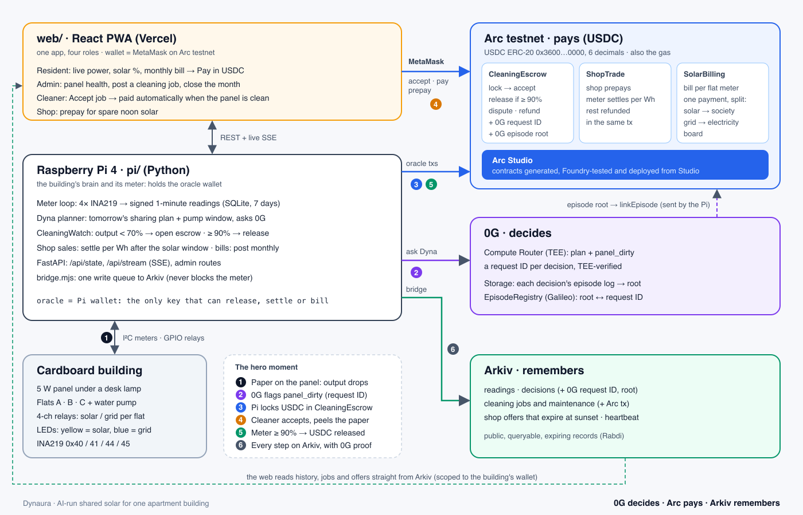

# Architecture diagram

The source is [`img/architecture.svg`](img/architecture.svg).

| Step | What happens | Where |
|---|---|---|
| 1 | Paper goes on the panel and its output drops. The Pi's INA219 meter sees it. | `pi/` |
| 2 | Dyna asks 0G Compute, which flags `panel_dirty`. Each decision has a 0G request ID and a TEE check. | 0G |
| 3 | The Pi (the oracle wallet) calls `CleaningEscrow.openJob(fee, deadline, outputBefore, ogRequestId)`, locking the USDC fee. | Arc |
| 4 | A cleaner accepts in the web app (MetaMask), then peels the paper off. | Arc |
| 5 | The meter reads ≥ 90%, so the Pi calls `release(jobId, outputAfter, proof)` and the USDC goes to the cleaner. When the decision's episode is on 0G Storage, the Pi also calls `linkEpisode(jobId, root)`. | Arc + 0G |
| 6 | Every step is written to Arkiv (through the bridge) with the 0G request ID, the root and the Arc transaction. The web reads the history straight from Arkiv. | Arkiv |

The contracts were generated, tested and deployed in **Arc Studio** (see [contracts/STUDIO.md](../contracts/STUDIO.md)). Their addresses are in [contracts/deployments.json](../contracts/deployments.json).
